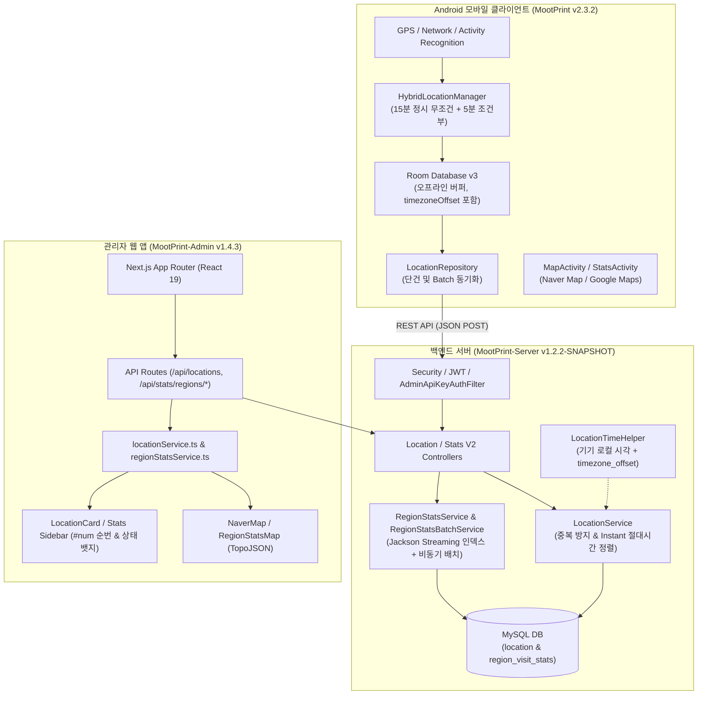

# MootPrint 🐾

> **스마트폰 백그라운드 위치 기록, 동기화 및 경로 시각화 통합 플랫폼**

MootPrint는 사용자의 이동 경로와 상태(배터리, 충전 여부, 네트워크 등)를 백그라운드에서 정교하게 수집하여 서버에 보관하고, 관리자 웹 화면과 모바일 앱에서 시간순 경로로 시각화하는 통합 위치 추적 서비스입니다.

본 저장소(MootPrint-Archive)는 **Android 모바일 앱 `MootPrint`**, **백엔드 API 서버 `MootPrint-Server`**, **관리자 웹 대시보드 `MootPrint-Admin`**로 구성된 전체 시스템의 최신 아키텍처, 핵심 기능, 컴포넌트 구조 및 변경 이력을 통합 관리합니다.

---

## 🏛️ 전체 시스템 아키텍처



---

## 📱 1. Android 모바일 앱 (`MootPrint`)

사용자의 일상 이동 경로를 배터리 소모를 최소화하면서 누락 없이 정밀 수집하는 모바일 클라이언트입니다.

- **버전**: `2.3.2` (`versionCode 13`)
- **타깃 SDK**: Android SDK 36 (Min SDK 26)

### 1.1 핵심 기능 및 추적 메커니즘

- **하이브리드 위치 추적 시스템**:
  - **15분 단위 정시 필수 기록 (00, 15, 30, 45분)**: 알람 슬롯(`scheduled_at`) 기준으로 Doze 지연이 발생해도 정시 기록으로 자동 승격. GPS 수신 실패 시 OS 최근 위치 캐시(`lastLocation` $\rightarrow$ `getLastKnownLocation`)로 폴백하여 기록 정합성 보장.
  - **5분 단위 조건부 기록 (05, 10, 20, 25분 등)**: `Activity Recognition API`와 OS 패시브 위치를 조합하여 실제 이동 중(지하철 등 포함)일 때만 수집. 이전 기록과 50m 이내인 경우 중복 저장 방지.
  - 고속 이동 중 미갱신 캐시 또는 정확도 500m 초과 위치 수신 시 30초 내 신규 측정(`maxUpdateAgeMillis = 0`) 1회 재요청.
- **백그라운드 생명주기 및 절전 최적화 대응**:
  - `Exact Alarm` $\rightarrow$ `WorkManager` 백업 체인 전환 지원.
  - `TrackingWatchdogWorker`: 15분 주기로 알람 체인 생존 상태를 감시하고 끊김 발생 시 자동 복구.
  - `BootReceiver`: 부팅 완료(`BOOT_COMPLETED`), 권한 변경, 앱 업데이트(`MY_PACKAGE_REPLACED`) 시 추적 체인 자동 승계 및 복구.
  - `LocationTrackingService`: 포그라운드 알림 유지 및 적응형(정지 5분 / 이동 1분 / 저전력 10분) 위치 보조 수집.
- **해외 타임존 이동 및 오프라인 일괄 전송 정렬 보호**:
  - `TimezoneOffsetUtils`: 측정 시점의 타임존 오프셋(`timezoneOffset`)을 캡처하여 보관.
  - 오프라인 상태(비행기 모드 등)에서 수집된 기록이 해외 착륙 후 일괄 전송될 때 동기화 시점의 기기 타임존으로 시간이 왜곡되는 문제를 방지하고, 측정 당시 오프셋 기준 단말기 로컬 시각(`toRecordLocalDateTime`)으로 직렬화 전송.
- **로컬 저장소 및 마이그레이션**:
  - `LocationDatabase`: Room DB v2 $\rightarrow$ v3 마이그레이션(`MIGRATION_2_3`) 적용. 미동기화 오프라인 레코드를 파괴하지 않고 `timezoneOffset` 컬럼을 안전하게 추가.
  - `DuplicatePreventionHelper`: SharedPreferences 기반 메모리 캐싱으로 중복 검사 시 DB 부하 제거.
- **사용자 인터페이스 (UI)**:
  - `MapActivity`: Naver Map(기본) 및 Google Maps 듀얼 렌더러 지원, 날짜별 궤적 조회, 시간 및 UTC 타임존 라벨 표기.
  - `StatsActivity`: 국내 행정구역(기초 시·군·구 / 광역 시·도) 방문 통계 지도, 정복률 요약, 지역 선택 시 정렬 순번(`#{num}`) 및 둥근 상태 뱃지(`bg_status_badge.xml`)가 포함된 상세 BottomSheet 제공.
  - `MainActivity`: Google Drive 내 `mootprint-<버전>-release.apk`만 비교하여 최신 버전 여부를 확인.
- **진단 및 안정성 도구**:
  - `LocationDiagnosticLogger`: 별도 권한 없이 `Downloads/MootPrint`에 7일 보존 주기로 판정 및 수집 사유를 기록 (개인정보 보호를 위해 위·경도 좌표는 제외).

---

## 🔧 2. 백엔드 API 서버 (`MootPrint-Server`)

모바일 클라이언트로부터 실시간 및 배치 위치 데이터를 수신하고 무결성을 검증하여 영구 보관하며, 관리자 및 클라이언트의 조회를 담당합니다.

- **버전**: `1.2.2-SNAPSHOT`
- **기술 스택**: Spring Boot 3.4.1, Kotlin, Spring Data JPA, MySQL 8.0+, Spring Security

### 2.1 핵심 기능 및 아키텍처

- **위치 데이터 수신 API**:
  - 단건 저장: `LocationSaveRequest`
  - 일괄(Batch) 저장: `LocationBatchRequest`
- **중복 방지 메커니즘**:
  - 일괄 전송 패킷 내부의 중복(`distinctBy { Triple(recordedAt, latitude, longitude) }`) 제거.
  - DB 레벨 중복 체크: `existsByUserAndRecordedAtAndLatitudeAndLongitude`를 통해 멱등성 보장.
- **하위 호환성 및 기존 데이터(20만 건) 보존 정책**:
  - 신규 컬럼 `timezone_offset VARCHAR(10) NULL DEFAULT '+09:00'` 적용.
  - 기존 20만 건의 KST 데이터는 일괄 변경하지 않고 `NULL` 또는 누락 시 `+09:00`(KST)으로 자동 폴백 처리.
- **타임존 정렬 역전 방지 (절대시간 정렬)**:
  - `LocationTimeHelper`: 단말기 로컬 기록 시각(`recorded_at`)과 오프셋(`timezone_offset`)을 결합해 UTC 기준의 절대 시각(`Instant`)으로 환산.
  - `LocationService.getLocationsByDate`: 요청된 날짜 범위의 데이터를 조회한 뒤, 절대 시각 오름차순(동일 시각일 경우 `id` 오름차순)으로 정렬하여 반환함으로써 해외 이동 시 시간 역전 현상을 원천 방지.
- **보안 및 인증**:
  - `CustomAuthFilter`, `ApiV2SecurityConfig`, `AdminApiKeyAuthFilter`를 통한 v2 JWT 및 관리자 API Key 인증 지원.
- **국내 행정구역 방문 통계 및 배치 처리**:
  - `RegionSpatialIndex`: `sigungu-backend.geo.json` 로딩 시 Jackson Streaming API(`JsonParser`)로 Feature 단위 파싱을 수행하여 제한된 JVM 힙 메모리(240MiB)에서도 `OutOfMemoryError` 없이 공간 인덱스를 구축.
  - `RegionSessionAnalyzer` / `RegionStatsService`: 위치 로그의 시·군·구 및 시·도 단위 방문(`VISITED`)·경유(`PASSED`)·미방문(`NONE`) 판정 및 체류일·누적 체류 시간 집계.
  - `RegionStatsBatchService` / `RegionStatsScheduler`: 매일 새벽 3시 자동 증분 집계 및 관리자 수동 집계(`INCREMENTAL`, `FULL_REAGGREGATE`, `FULL_REMAP`) 지원. 수동 집계는 비동기 실행(`202 Accepted`) 후 작업 상태를 조회.

---

## 🌐 3. 관리자 웹 대시보드 (`MootPrint-Admin`)

저장된 위치 로그를 날짜별로 검색하고 시간순 이동 궤적과 상세 디바이스 상태를 시각적으로 분석하는 관리자 웹 애플리케이션입니다.

- **버전**: `1.4.3`
- **기술 스택**: Next.js 15.5.7 (App Router), React 19, TypeScript, Tailwind CSS 4, Naver Maps API v3, TopoJSON Client, Axios, Lucide React

### 3.1 핵심 기능 및 UI/UX

- **지도 시각화 (`NaverMap.tsx`)**:
  - 네이버 지도 API v3 기반의 동적 렌더링.
  - 시간 순서에 따른 번호 마커 표시 및 이동 궤적 폴리라인(주황색) 연결.
  - 레이아웃을 반영한 스마트 지도 중심점 계산 및 마지막 기록 위치 자동 포커스.
  - 마커 클릭 시 목록 카드 하이라이트 및 카드 클릭 시 지도 중심 이동의 양방향 인터랙션.
- **타임존 기반 시간순 정렬 및 화면 표기 (`locationService.ts`)**:
  - `parseRecordedEpochMs`: `recordedAt` 로컬 시각과 `timezoneOffset`(기본값 `+09:00`)을 결합하여 절대 UTC Epoch 밀리초를 계산하고 정렬하여 시간 역전 방지.
  - `formatLocalRecordedTime`: 단말기 로컬 시각의 `HH:mm:ss`를 가감 없이 정확히 표시하며, `+09:00` 이외의 타임존일 경우 `(UTC+8)`, `(UTC+4)` 등 오프셋 라벨을 명시.
- **위치 목록 카드 (`LocationCard.tsx`)**:
  - 위치 순번, 기록 시각, 위·경도 좌표, 배터리 잔량 및 충전 상태, 네트워크 종류(WiFi/LTE/None)와 연결망 이름 직관적 표시.
- **CORS 프록시 (`src/app/api/locations/route.ts`, `/api/stats/regions/*`)**:
  - Next.js 서버 라우트를 통한 백엔드 API 호출로 브라우저 CORS 문제 해결 및 `X-Admin-Api-Key` 헤더 전달.
- **국내 행정구역 방문 통계 대시보드 (`src/app/stats/page.tsx`, `RegionStatsMap.tsx`)**:
  - Naver Map v3 + TopoJSON(`sido-client.topo.json`, `sigungu-client.topo.json`) 기반 경량 폴리곤 렌더링.
  - 사용자별 기초(시·군·구) / 광역(시·도) 방문 통계 조회, 검색 및 상태 필터 탭(`전체`, `방문`, `경유`, `미방문`) 지원.
  - 정렬 기준(`방문 > 경유 > 미방문`, `체류일 > 체류시간 > 코드`) 적용, 목록 내 순번(`#{num}`) 표시, 조회 시 최상단 정렬 지역 기본 선택.
  - 수동 집계 모드(`최신 로그만 반영`, `방문 규칙으로 재계산`, `처음부터 전체 재집계`) 비동기 실행 및 2초 간격 상태 폴링, `?` 도움말 팝업, 모바일 헤더(`<-` 아이콘 전용 뒤로 가기) 지원.

---

## 📋 4. 주요 변경 이력 (Version History)

### v2.3.2 (2026-11-25)

- **Android 앱 (`MootPrint`)**:
  - 무음 세션 복구 실패 시 로그아웃 없이 복구할 수 있도록 `MainActivity` 선제 재인증(실행당 1회) 및 `StatsActivity` 원탭 **"Google 계정 재인증"** 버튼 추가 (`AuthSessionManager.completeInteractiveV2Login`)
  - 인증 실패 원인 코드 분류(`SILENT_SIGNIN_*`, `V2_LOGIN_HTTP_*` 등) 및 `LocationDiagnosticLogger` `[AUTH]` 진단 로그 기록, `AuthRepository` 레거시 폴백 전 `silentSignIn()` 1회 재시도 추가
  - 사용자 카드 길게 누르기 로그아웃 다이얼로그 추가 및 로그아웃 시 `HybridLocationManager.stopLocationTracking()`(`stopService`) 호출로 위치 추적 체인 즉시 정지
  - v2 세션 복구 및 재접속 완료 직후 미동기화(`isSynced = false`) 위치 기록을 백그라운드에서 즉시 업로드(`flushUnsyncedLocationsAsync`)

### v2.3.1 (2026-11-25)

- **Android 앱 (`MootPrint`)**:
  - 구버전(api/v2 도입 전) 사용자 업데이트 직후 앱 실행(`MainViewModel`) 및 통계 조회(`RegionStatsRepository`) 시 Google `silentSignIn()` 기반 v2 JWT 세션 즉시 자동 발급 및 단일 비행(`recoveryMutex`) 중복 방지 (`AuthSessionManager`, `AuthSessionWorker`)
  - 만료·폐기된 Refresh Token(`SessionRevoked`) 발생 시 1회 자동 재발급 시도 및 실패 시 재로그인 안내 개선

### v2.3.0 / v1.2.2-SNAPSHOT / v1.4.3 (2026-11-24 ~ 2026-11-25)

- **공통 (국내 행정구역 방문 통계 시스템 구축)**:
  - 국내 시·군·구 및 광역(시·도) 단위 `VISITED` / `PASSED` / `NONE` 판정, 정복률, 체류일 및 누적 체류 시간 통계 기능 도입.
- **Android 앱 (MootPrint v2.3.0)**:
  - `StatsActivity` 추가: Naver Map 기반 국내 시·군·구 / 시·도 방문 통계 시각화.
  - 지역 상세 BottomSheet(`dialog_region_detail.xml`) 개선: 도시 코드 제거 후 정렬 순번(`#{num}`) 표시, 둥근 상태 뱃지(`bg_status_badge.xml`) 및 텍스트 가로·세로 중앙 정렬 적용.
  - `MainActivity`: 최신 앱 버전 확인 시 `-release.apk` 파일만 비교하도록 정규식 개선.
- **백엔드 서버 (MootPrint-Server) v1.2.2-SNAPSHOT)**:
  - `RegionSpatialIndex`: Jackson Streaming API(`JsonParser`) 기반 Feature 단위 파싱으로 GeoJSON 로딩 시 힙 메모리 사용량 절감(`OutOfMemoryError` 해결).
  - `RegionStatsBatchService` / `AdminRegionStatsV2Controller`: 수동 집계 비동기 실행(`202 Accepted`) 및 상태 조회 엔드포인트(`/recompute/status`) 추가.
- **관리자 웹 (MootPrint-Admin v1.4.3)**:
  - `/stats` 페이지 및 `RegionStatsMap.tsx` 추가: TopoJSON 경량화 + Naver Map v3 전환.
  - 지역 목록 정렬 기준(`방문 > 경유 > 미방문`, `체류일 > 체류시간 > 코드`) 적용, 목록 내 `#{num}` 순번 표시, 조회 시 최상단 정렬 지역 기본 선택.
  - 수동 집계 비동기 폴링, 직관적 모드 명칭 및 `?` 도움말 팝업, 모바일 헤더 뒤로 가기 버튼 간소화(`<-`) 적용.

### v2.0.1 (2026-11)

- **공통 (Architecture / Data Integrity)**:
  - 해외 타임존 이동 및 오프라인 일괄 전송 시 발생하는 시간 정렬 역전(Interleaving) 현상 해결.
  - 기존 20만 건의 한국 표준시(KST) 데이터에 영향을 주지 않는 하위 호환 구조 확립 (`timezone_offset` `NULL` / 누락 시 `+09:00` 자동 폴백).
- **Android 앱 (MootPrint)**:
  - `TimezoneOffsetUtils` 추가: 측정 시점 오프셋 캡처 및 오프라인 일괄 동기화 시 로컬 기록 시각 보존.
  - Room DB v3 마이그레이션(`MIGRATION_2_3`) 적용 (비파괴 컬럼 추가).
  - 앱 버전 `2.0.1` (`versionCode 6`) 릴리스.
- **백엔드 서버 (MootPrint-Server)**:
  - `Location` 엔티티 및 DTO에 `timezoneOffset` 추가.
  - `LocationTimeHelper`: 단말기 로컬 시각 + 타임존 오프셋 기반 절대 시각(`Instant`) 환산 및 정렬 로직 적용.
  - 버전 `1.0.1-SNAPSHOT` 반영.
- **관리자 웹 (MootPrint-Admin)**:
  - `locationService.ts`: `parseRecordedEpochMs` 기반 절대시간 정렬 및 `(UTC+X)` 타임존 라벨 포맷팅 적용.

### v1.6.1 (이전 안정 버전)

- 하이브리드 위치 추적 시스템 (15분 정시 무조건 + 5분 조건부 이동 기록) 안정화.
- Doze 모드 및 절전 대응을 위한 `TrackingWatchdogWorker` 및 부팅/업데이트 자동 승계 도입.
- 고속 이동 환경(KTX 등) 수집 누락 방지를 위한 위치 캐시 재요청 보완.
- MediaStore 기반 진단 로그(`LocationDiagnosticLogger`) 도입.

---

## 🛠️ 개발 및 실행 안내

### 사전 요구사항

- **Android**: Android Studio Ladybug+, JDK 17+, Android SDK 36
- **Backend**: JDK 17+, MySQL 8.0+
- **Admin**: Node.js 18+, npm

### 프로젝트별 실행 명령

```bash
# Android App (MootPrint)
cd MootPrint && ./gradlew assembleDebug

# Backend Server (MootPrint-Server)
cd MootPrint-Server && ./gradlew bootRun

# Web Admin (MootPrint-Admin)
cd MootPrint-Admin && npm install && npm run build && next build && npm run start
```
